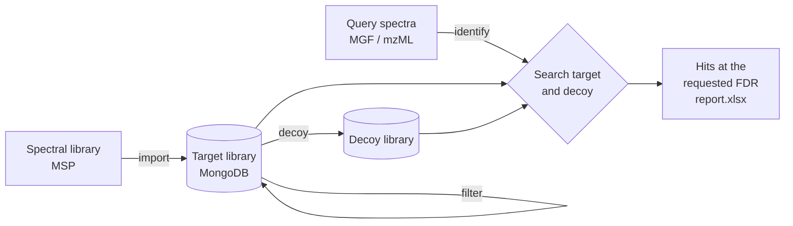

# MetaPhoenix

**Entropy-based decoy generation and accurate FDR estimation for metabolite annotation by MS/MS spectral library search.**

[](https://github.com/anshaowei/MetaPhoenix/actions/workflows/ci.yml)
[](https://doi.org/10.1093/bib/bbae056)
[](LICENSE)


MetaPhoenix is the reference implementation of [*Ion entropy and accurate entropy-based FDR estimation in metabolomics*](https://doi.org/10.1093/bib/bbae056) (Briefings in Bioinformatics, 2024). It builds target and decoy MS/MS spectral libraries and annotates query spectra by library search, controlling the false discovery rate (FDR) with the target-decoy approach.

Target-decoy FDR estimation is standard in proteomics, but in metabolomics it is hard to construct decoys that behave like real spectra, because small molecules are structurally diverse and do not follow simple fragmentation rules. The paper introduces **ion entropy**, a measure of how informative a fragment ion is across a spectral library, and uses it, together with spectral entropy, to generate decoy spectra that give more accurate FDR estimates than existing decoy methods.

## Contents

* [Features](#features)
* [How it works](#how-it-works)
* [Installation](#installation)
* [Quick start](#quick-start)
* [Command reference](#command-reference)
* [Configuration](#configuration)
* [Reproducing the paper](#reproducing-the-paper)
* [Project structure](#project-structure)
* [Citation](#citation)
* [License](#license)

## Features

* **Library import** from GNPS, MassBank-Europe, MassBank of North America (MoNA) and generic MSP files into MongoDB.
* **Library filtering** with the quality rules used in the paper (precursor, peak count, mass range, MS level, ion mode).
* **Decoy generation** with six strategies: ion entropy–based and spectral entropy–based decoys from the paper, each with a precursor-retaining variant, and the Naive and XYMeta methods for comparison. Decoys are reproducible with a random seed.
* **Spectral library search** of MGF or mzML query spectra with the weighted spectral entropy similarity, reporting hits at a chosen FDR as an Excel report.

## How it works



1. **Target library.** A reference spectral library is imported and cleaned.
2. **Decoy library.** One decoy spectrum is generated for each target spectrum, with the same precursor m/z.
   * *Ion entropy–based:* for each fragment of a target spectrum, the matching fragment ions are collected from all library spectra with a similar precursor m/z, and the entropy of their intensities is computed. Fragment m/z values are kept and their intensities are reassigned in reverse order of ion entropy.
   * *Spectral entropy–based:* intensities are permuted among the fragment m/z values, so each decoy has exactly the same spectral entropy as its target.
3. **Search and FDR control.** Each query spectrum is scored against the target and decoy libraries. The score threshold is chosen so that the estimated FDR, computed from the number of decoy and target hits above the threshold, does not exceed the requested level.

See the [paper](https://doi.org/10.1093/bib/bbae056) for the method and its evaluation, and [docs/implementation-notes.md](docs/implementation-notes.md) for the places where the code differs from the paper's Methods text.

## Installation

**Requirements**

* Java 17 or newer (tested with 17, 21 and 25)
* Maven 3.9 or newer
* [MongoDB](https://www.mongodb.com/docs/manual/installation/) 4.4 or newer, running on `localhost:27017` by default
* Redis (optional, only used as a cache)

**Build**

```bash
git clone https://github.com/anshaowei/MetaPhoenix.git
cd MetaPhoenix
mvn -DskipTests clean package
```

This produces `metaphoenix-core/target/metaphoenix-core-1.1.0.jar`. Run `mvn test` to run the unit tests; they do not need MongoDB.

**Run**

MetaPhoenix reads commands from standard input:

```bash
java -jar metaphoenix-core/target/metaphoenix-core-1.1.0.jar --command.runner.enabled=true
```

The usage is printed at startup. Enter one command per line; a command with missing or invalid parameters prints the usage and the next command is read. Closing the input (Ctrl-D) stops the command runner. Commands can also be read from a file:

```bash
java -jar metaphoenix-core/target/metaphoenix-core-1.1.0.jar --command.runner.enabled=true < commands.txt
```

Without `--command.runner.enabled=true` only the HTTP API is started (see [Project structure](#project-structure)) and commands typed into the terminal are ignored.

## Quick start

Build a target library from the [MassBank-Europe](https://github.com/MassBank/MassBank-data/releases) MSP release, generate ion entropy–based decoys and annotate the spectra in `query.mgf` at 1% FDR:

```text
import -f MassBank_NIST.msp -l massbank -t massbank
filter -l massbank
decoy -l massbank -s IonEntropyBased -seed 42
identify -f query.mgf -l massbank -fdr 0.01 -o query-report.xlsx
```

`query-report.xlsx` lists the accepted hits. Generate the decoy library once and reuse it for any number of `identify` runs.

## Command reference

| Command | Purpose |
|---|---|
| [`import`](#import) | Import an MSP file as a new library |
| [`filter`](#filter) | Apply the paper's quality filters to a library |
| [`decoy`](#decoy) | Generate a decoy library |
| [`identify`](#identify) | Search query spectra and report hits at a given FDR |

### import

```text
import -f <library.msp> -l <library> [-t <format>]
```

Imports an MSP file into a new library named `<library>`.

| `-t` | Source | Download |
|---|---|---|
| `msp` (default) | Generic MSP (`NAME`, `PRECURSORMZ`, `PRECURSORTYPE`, `FORMULA`, `INCHIKEY`, `SMILES`, `IONMODE`, ...) | |
| `gnps` | GNPS spectral library in MSP format, for example `ALL_GNPS.msp` | [GNPS library downloads](https://external.gnps2.org/gnpslibrary) |
| `massbank` | MassBank-Europe MSP release (`MassBank_NIST.msp`) | [MassBank-data releases](https://github.com/MassBank/MassBank-data/releases) |
| `mona` | MassBank of North America (MoNA) MSP export | [MoNA downloads](https://mona.fiehnlab.ucdavis.edu/downloads) |

### filter

```text
filter -l <library>
```

Cleans a library with the rules described in the paper:

1. Remove spectra without m/z values, intensities, precursor m/z, ion mode or InChIKey.
2. Remove peaks with intensity below 1% of the base peak.
3. Remove spectra without a peak within 10 ppm of the precursor m/z.
4. Remove spectra with fewer than 5 peaks above 2% relative intensity.
5. Remove spectra with precursor m/z or exact mass above 1000.
6. Keep MS2 spectra only.
7. Keep positive ion mode spectra only.

> [!WARNING]
> The library is replaced by the filtered spectra. Re-import the file to get the unfiltered library back.

### decoy

```text
decoy -l <library> [-s <strategy>] [-ppm <ppm>] [-seed <seed>] [-overwrite]
```

Generates a decoy library, stored as `<library>-<strategy>`.

| Option | Default | Description |
|---|---|---|
| `-s` | `IonEntropyBased` | Decoy strategy, see below |
| `-ppm` | `10` | m/z tolerance in ppm |
| `-seed` | none | Random seed. The same seed and library always give the same decoy library; without a seed every run differs |
| `-overwrite` | off | Replace an existing decoy library. Without it, nothing is generated if the decoy library already exists, so existing decoys (such as the ones used for the paper) are never replaced by accident |

| Strategy | Description |
|---|---|
| `IonEntropyBased` | Ion entropy–based decoys (paper) |
| `IonEntropyBased_PR` | As above, keeping the precursor ion peak of the target |
| `SpectralEntropyBased` | Spectral entropy–based decoys (paper) |
| `SpectralEntropyBased_PR` | As above, keeping the precursor ion peak of the target |
| `Naive` | Naive decoys, for comparison |
| `XYMeta` | XYMeta decoys, for comparison |

The fragmentation tree–based strategy (`FragmentationTreeBased`, using SIRIUS) is not available in this version.

### identify

```text
identify -f <spectra.mgf|spectra.mzML> -l <library> -fdr <fdr> [-s <strategy>] [-ppm <ppm>] [-o <report.xlsx>]
```

Searches query spectra against a target library and its decoy library and reports the hits that pass the FDR threshold.

| Option | Default | Description |
|---|---|---|
| `-f` | required | Query spectra in `.mgf` or `.mzML` format |
| `-l` | required | Target library |
| `-fdr` | required | FDR threshold, for example `0.01` or `0.05` |
| `-s` | `IonEntropyBased` | Decoy library used to estimate the FDR. It has to be generated with `decoy` first |
| `-ppm` | `10` | Precursor m/z tolerance in ppm |
| `-o` | `report.xlsx` | Output report |

Only MS2 query spectra with a precursor m/z are searched, and peaks with zero intensity are removed. Spectra are scored with the weighted spectral entropy similarity ([Li et al., 2021](https://doi.org/10.1038/s41592-021-01331-z)). If no score threshold reaches the requested FDR, no hits are reported.

The report has one row per accepted hit:

| Column | Description |
|---|---|
| `querySpectrumId` | 0-based position of the query spectrum among the searched spectra |
| `CompoundName`, `InChIKey`, `Smiles`, `PrecursorAdduct` | Annotation of the matched library spectrum |
| `PrecursorMz` | Precursor m/z of the matched library spectrum |
| `Score` | Spectral entropy similarity |
| `LibrarySpectrumId` | ID of the matched library spectrum in MongoDB |

## Configuration

Default configuration lives in [application.properties](metaphoenix-core/src/main/resources/application.properties). Settings can be changed with environment variables:

| Variable | Default | Description |
|---|---|---|
| `MONGODB_URI` | `mongodb://localhost:27017/metaphoenix` | MongoDB connection string, including the database name |
| `METAPHOENIX_REPOSITORY` | `~/metaphoenix-data` | Working directory for data files used by the HTTP API |
| `SERVER_PORT` | `8081` | HTTP port |
| `COMMAND_RUNNER_ENABLED` | `false` | Read commands from standard input (same as `--command.runner.enabled=true`) |
| `REDIS_ENABLED` | `false` | Enable the Redis cache |
| `REDIS_HOST`, `REDIS_PORT`, `REDIS_DATABASE` | `localhost`, `6379`, `1` | Redis connection, used only when `REDIS_ENABLED=true` |
| `REDIS_HEALTH_ENABLED` | `false` | Include Redis in the actuator health check |

Alternatively, copy [application-example.properties](metaphoenix-core/src/main/resources/application-example.properties) to `metaphoenix-core/src/main/resources/application-local.properties`, edit it, rebuild and start with `--spring.profiles.active=local`.

## Reproducing the paper

The benchmark in the paper searches MassBank of North America (MoNA, July 2023) spectra against GNPS (December 2023) as the target library. A hit is counted as correct when the first block of its InChIKey matches that of the query, which gives the true FDR to compare with the estimated one.

* **Code.** Use the `dev` branch or the latest [release](https://github.com/anshaowei/MetaPhoenix/releases). The `master` branch (tag `v1.0.0`) is an archive of the original code under its former name, MSLibrary.
* **Data.** Download `ALL_GNPS.msp` from the [GNPS library downloads](https://external.gnps2.org/gnpslibrary) and the MSP export from [MoNA](https://mona.fiehnlab.ucdavis.edu/downloads), then build the libraries:

  ```text
  import -f ALL_GNPS.msp -l ALL_GNPS -t gnps
  import -f MoNA-export-LC-MS-MS_Spectra.msp -l MassBank-MoNA -t mona
  filter -l ALL_GNPS
  filter -l MassBank-MoNA
  decoy -l ALL_GNPS -s IonEntropyBased -seed 42
  ```

  Both libraries keep growing, so current downloads contain more spectra than the versions used in the paper. The paper's GNPS library was imported with an earlier version of the MSP parser that kept only the first word of text fields such as the compound name, instrument and comment. These fields are not used by `filter`, `decoy` or `identify`.
* **Benchmark.** The estimated-vs-true FDR comparison is computed by `Reporter.compareDecoyStrategy` in `metaphoenix-core`, which is not exposed as a command.
* **Existing databases.** Databases created with MSLibrary, including the one used for the paper, can be read without migration. See [docs/mslibrary-databases.md](docs/mslibrary-databases.md).
* **Differences from the paper text.** The estimated FDR formula, one fragment tolerance and the similarity weighting differ from the Methods text; the figures were produced with the code as it is. See [docs/implementation-notes.md](docs/implementation-notes.md).

## Project structure

```text
MetaPhoenix
├── metaphoenix-client   algorithms, parsers, filters, domain model and MongoDB access
│   └── algorithm        decoy generation, ion and spectral entropy, similarity, identification
├── metaphoenix-core     Spring Boot application: configuration, command runner, HTTP controllers
└── docs                 implementation notes and compatibility with MSLibrary databases
```

`metaphoenix-core` also serves an HTTP API on port 8081 for browsing libraries, spectra and compounds (`/library`, `/spectrum`, `/compound`, ...). It was written for an internal web front end that is not part of this repository and is not a stable public interface.

## Citation

If you use MetaPhoenix, please cite:

> An S, Lu M, Wang R, Wang J, Jiang H, Xie C, Tong J, Yu C. Ion entropy and accurate entropy-based FDR estimation in metabolomics. *Briefings in Bioinformatics*. 2024;25(2):bbae056. [doi:10.1093/bib/bbae056](https://doi.org/10.1093/bib/bbae056)

PubMed: [38426325](https://pubmed.ncbi.nlm.nih.gov/38426325/) · Free full text: [PMC10939419](https://pmc.ncbi.nlm.nih.gov/articles/PMC10939419/)

```bibtex
@article{an2024ionentropy,
  title = {Ion entropy and accurate entropy-based FDR estimation in metabolomics},
  author = {An, Shaowei and Lu, Miaoshan and Wang, Ruimin and Wang, Jinyin and Jiang, Hengxuan and Xie, Cong and Tong, Junjie and Yu, Changbin},
  journal = {Briefings in Bioinformatics},
  volume = {25},
  number = {2},
  pages = {bbae056},
  year = {2024},
  doi = {10.1093/bib/bbae056}
}
```

The citation is also available in [CITATION.cff](CITATION.cff) and through the "Cite this repository" button on GitHub.

MetaPhoenix scores spectra with the entropy similarity of Li et al. If you report these scores, please also cite:

> Li Y, Kind T, Folz J, Vaniya A, Mehta SS, Fiehn O. Spectral entropy outperforms MS/MS dot product similarity for small-molecule compound identification. *Nature Methods*. 2021;18(12):1524–1531. [doi:10.1038/s41592-021-01331-z](https://doi.org/10.1038/s41592-021-01331-z)

## License

MetaPhoenix is released under the [Apache License 2.0](LICENSE).

Questions and bug reports: [GitHub Issues](https://github.com/anshaowei/MetaPhoenix/issues).
